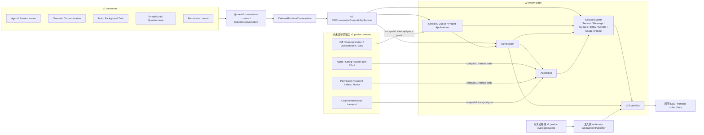

# Local Runtime v2 Session / Conversation 迁移依赖审计

## 1. 复审基线与结论

- 复审日期：2026-07-29
- 目标分支：`origin/feat/local-runtime-v2-session`
- 接入分支：`origin/feat/local-runtime-v2-agent-host-2`
- 接入分支 SHA：`590d7f19c22d2d58cd32fe7e238724c1af9655ca`
- Git 关系：目标基线 `50a60238ca9735ee008b9de347842a9511fd69fb`
  是把 AgentHost 接入分支合入 Session 分支的 merge commit；本文按该合并后的 production graph 复审。
- 本轮实现基线：`50a60238ca9735ee008b9de347842a9511fd69fb`
- 最终交付 tip：本文所在 commit；由于 Git
  commit 不能在自身内容中记录自身 SHA，精确值以当前交付分支的 Git metadata 为准。
- 复审范围：Local Runtime v2 production owner host 中的 Session、Message、Queue、Turn、canonical
  history、stream、usage、Project，以及所有仍调用这些能力的 v1 consumer。

最终结论：

1. **Session / 对话核心 ownership 已迁到 v2。** production 只构造一套
   `SessionSystemOwner`，Applications、TurnSystem、AgentHost、ChannelSystem、Cron 和
   `RuntimeConversation` 使用同一套 repository/service graph。
2. **v2 内部依赖方向正确。** `TurnSystem -> SessionSystem` 在
   `packages/local-runtime-v2/src/services.ts` 和各 service facade 中直接装配，不经过 `compat/v1`。
3. **v1 调用 v2 的入口完整。** 中立的 `@mavis/conversation-contract` 定义 19 个接口，
   `V1ConversationCompatibilityService` 全部实现；production v1 host 注入
   `DeferredRuntimeConversation`，并关闭 legacy conversation writer。
4. **v2 对 v1 只保留尚未迁移的独立产品 capability。**
   Agent 配置、模型凭证、Tool、Permission、Diff、Channel transport、Questionnaire、Thread
   Goal、Preference 等通过窄端口注入；v2 不再从 v1 获取 Session、Message、Queue、Turn、history 或 stream 的权威实现。
5. **34 个 Session / Queue / Project Application route 均由 production v2 graph 挂载。**
   不再存在“底层数据写 v2、HTTP 业务语义仍回落 v1”的混合 owner。
6. `requestRotation` 已从 v2 allowlist 和 UI 调用链删除；IDL 暂时要求保留的 generated
   handler 只返回稳定 unsupported，不回落 v1。

因此，对 production Local Runtime v2 owner host，可以判定本轮 Session
/ 对话迁移闭环。本文末尾仍列出几项明确的兼容边界和工程取舍；它们不再承担 Session / 对话核心业务。

## 2. 如何阅读三类依赖



三条判断规则：

- **v2 内部依赖**：owner 之间只依赖 public capability，在 `services.ts` 或 service
  initializer 组装；不能绕到 `compat/v1`。
- **v1 -> v2**：v1 只能依赖中立 contract，不能直接 import v2 repository 或 service implementation。
- **v2 -> v1**：只允许尚未迁移且能够独立定义 ownership 的产品能力；不能把 v1 Session / Message /
  Queue store 当作 v2 的实现。

## 3. 方向一：Local Runtime v2 内部依赖

### 3.1 唯一 production owner graph

组装顺序位于 `packages/local-runtime-v2/src/services.ts`：

```text
initializeSessionSystem
  -> initializeChannelSystem
  -> initializeTurnSystem
     -> createLocalAgentHost
  -> initializeCronService
  -> initializeSessionApplicationSystem(owner: same SessionSystemOwner)
  -> initializeApplications
  -> createV1ConversationCompatibility
```

关键点：

- `initializeSessionApplicationSystem` 只接收已有的 `owner`，不接收
  `AppDb`，也不再创建第二套repository。
- `RuntimeServices.applications` 是 required，不是 optional prerequisite。
- `createRuntimeConversation` 复用同一个 Session lifecycle、query、Message、Queue、Turn 和 Root
  Application。
- `services.ts` 只从 Application root index 和 service facade 取类型/能力；架构测试阻止 composition
  root、HTTP、compat adapter 深入 import service implementation。

### 3.2 TurnSystem -> SessionSystem 的逐项依赖

| TurnSystem 所需 capability        | v2 提供者                          | 业务场景                                              | 合理性                                    |
| --------------------------------- | ---------------------------------- | ----------------------------------------------------- | ----------------------------------------- |
| `sessions.repository.has`         | Session repository                 | Turn admission 前确认 Session 存在                    | Session identity 属于 v2                  |
| `sessions.deletion.begin`         | `SessionDeletionGate`              | 校验 Session 存在并开启当前进程的删除 gate            | 单进程低频删除不需要 durable Session 状态 |
| `sessions.deletion.complete`      | `SessionDeletionGate`              | Session cleanup 成功后释放进程内 gate                 | gate 生命周期覆盖完整删除 use case        |
| `sessions.deletion.turnAdmission` | `SessionDeletionGate`              | 新 submit / recovery 拒绝正在删除的 Session           | admission 仍在权威 repository mutation 点 |
| `queue.priorityFence`             | Session Queue owner                | Queue item 优先于普通 direct submit                   | Queue 排序规则只在一个 owner              |
| `queue.submission`                | Session Queue owner                | `submit(allowQueue=true)` 内部 durable enqueue        | producer 不接触 enqueue capability        |
| `queue.createDispatch`            | Session Queue owner                | claim committed Queue item 后交给 Turn executor       | Queue 持久化与 Turn 执行分离              |
| `queue.facts`                     | Session Queue committed fact hub   | queued completion 观察 accepted/cancelled/expired     | completion 不引入第二个 Queue store       |
| `agentProjection.failures`        | Session agent projection           | preflight / runtime 失败投影 Session、Message、stream | 对话状态归 SessionSystem                  |
| `createMessageDelivery`           | v2 Message commit + stream + title | Turn accepted 后提交用户消息，再启动 Turn             | 消息与 Turn receipt 有确定顺序            |
| `disposeRuntimeSession`           | v2 AgentHost lifecycle             | 删除 Session 前释放 in-memory Agent runtime           | 运行态由 AgentHost owner 清理             |

这里没有 v1 host 或 v1 Session store 注入 TurnSystem。

### 3.3 AgentHost -> SessionSystem 的逐项依赖

| AgentHost 所需能力                    | v2 owner                              | 业务场景                                           |
| ------------------------------------- | ------------------------------------- | -------------------------------------------------- |
| Session execution snapshot            | Session repository / execution source | 读取 agent、workspace、runtime、model              |
| canonical history read/append/replace | Session canonical history provider    | Prompt history、Turn commit、compaction            |
| display Message projection            | Session Message repository            | 用户、assistant、tool display rows                 |
| Session state projection              | Session agent projection              | running、idle、error、aborted                      |
| stream frame projection               | Session stream service                | live SSE、resume、durable replay                   |
| usage projection                      | Session Usage repository              | 每 Turn token usage                                |
| compaction facts                      | Session projection                    | started/completed/failed                           |
| content rollback projection           | Session projection                    | rewind display Message、写 durable stream boundary |
| Turn facts                            | Turn repository                       | Turn admission、lease、receipt、terminal state     |

AgentHost 的 product port 中已删除重复的 Session capability。`getDefaults`、Root record、Session
title policy 等不再作为第二套对话依赖挂在 Host 内。

### 3.4 轻量删除 gate 与明确取舍

删除协调只覆盖会与 active Turn 或对话数据清理直接冲突的入口：

- `SessionDeletionGate.begin` 先确认 v2 Session record 存在，再把 `sessionId` 放入进程内 `Set`；
- 同一个 gate 的 `turnAdmission` 注入 Turn repository 与 user Message commit， `queueAdmission`
  注入 Queue repository；
- TurnSystem 在 gate 内 block operation、quiesce Dispatcher、drain/abort active
  Turn、删除 Turn-owned 数据，并调用 Application 注入的 Session-owned cleanup；
- cleanup 成功后才调用 `complete` 并释放 operation gate；失败时当前进程保持 fail closed，显式重试；
- 删除协调不持久化 Session 状态。

普通 Session metadata update、child create/reparent 和 Root
replacement 不再参与删除 gate。这样会接受进程在 cleanup 中途崩溃、极低概率并发 Root/parent/child
mutation 的窗口；恢复依赖 tombstone-first、record-last 和幂等 cleanup，而不是为低频删除维护 durable
Session/tree 状态机。active Turn 的 durable lock 与 exact
settlement 仍保留，因为它保护正在写入的核心对话数据。

### 3.5 Event ownership

v2 核心 committed fact 现在直接写 v2 EventBus：

| Fact 来源                        | 主要 public event                                                   |
| -------------------------------- | ------------------------------------------------------------------- |
| Session lifecycle                | `session.created`、`session.title_updated`、`session.deleted`       |
| Queue commit                     | `session.queue.updated`                                             |
| Root replacement / archive title | `agent.updated`、`session.title_updated`                            |
| Turn lifecycle                   | `session.start`、`session.finish`、`session.error`、`session.abort` |
| Compaction                       | `session.compaction.started/completed/failed`                       |
| Output recall                    | `content.retry.exceeded`、`message.rewind`                          |

最终 ownership 与数据流是：

```text
v2 producers ─┐
              ├─ writeGlobalEvent -> v2 EventBus -> 所有 subscriber
v1 producers ─┘
```

- `background-runtime.ts` 创建并关闭唯一的 v2 EventBus；
- v2 committed-fact projector 直接调用 `writeGlobalEvent`；
- v2-owner 在创建 v1 host 时，通过 `CreateLocalRuntimeHostOptions.globalEventPublisher`
  注入 write-only publisher；
- `compat/v1/runtime.ts` 只持有 deferred publisher binding，`services.ts` 在 ready 时调用
  `bindPublisher(writeGlobalEvent)`，不再调用或暴露 v1 `subscribeGlobalEvents`；
- close 先把 services 标记为 closed，再解除 publisher
  binding；即使旧 producer 保留函数引用，也不会在 shutdown 后重复投递；
- pure v1 runtime 未注入 publisher 时，`LocalRuntimeApiHost` 仍默认写自己的
  `GlobalEventSource`，保持独立运行能力；该 source 不是 v2-owner 路径的 source。

Desktop wrapper 的 exactly-once 规则也按 owner 收口：注入 `RuntimeConversation` 时，
`session.title_updated` 和 `session.deleted` 只由 v2 lifecycle committed fact 发布；v1
wrapper 不再发布它们。`session.pinned_updated` 仍由尚未迁移的 v1 Pin
owner 发布，并经同一个 write-only publisher 进入 v2 EventBus。因此不存在 v1 -> v2 ->
v1 回环，也没有同一 title/delete 业务事件的双 publisher。

## 4. 方向二：v1 调用 v2 Session / 对话

### 4.1 注入链

```text
packages/agent-modules/conversation-contract
  -> DeferredRuntimeConversation
  -> v1 CreateLocalRuntimeHostOptions.runtimeConversation
  -> v1 consumers only see RuntimeConversation

packages/local-runtime-v2/src/services.ts
  -> createV1ConversationCompatibility
  -> V1ConversationCompatibilityService
  -> compatibility.conversation.bind(runtimeConversation)
```

production host 只注入：

```text
runtimeConversation: DeferredRuntimeConversation
```

因此：

- v1 consumer 可以在 v2 service ready 前安全持有 deferred contract；
- bind 失败、startup 失败和 shutdown 都有显式 terminal state；
- standalone V1 Conversation 永久 fail-closed，且没有可重开的开关；
- 不会因某个 consumer 忘记判断 v2 readiness 而静默写回 v1。

### 4.2 `RuntimeConversation` 19 个接口逐项复审

#### Query（3）

| 接口                 | v2 实现                         | 业务场景                                           | 结论                                             |
| -------------------- | ------------------------------- | -------------------------------------------------- | ------------------------------------------------ |
| `query.getSession`   | `SessionQueryService.find`      | Agent、Task、Channel、Permission 按 ID 读 Session  | v2 权威读                                        |
| `query.listSessions` | `SessionQueryService.listExact` | sidebar、Thread Goal recovery、Root/child 查询     | v2 filter/pagination                             |
| `query.listMessages` | `MessageQueryService.list`      | UI history、Permission recent context、Turn result | 先执行 legacy display readiness，再读 v2 Message |

#### Lifecycle（5）

| 接口                           | v2 实现                                                           | 业务场景                                | 结论                                                             |
| ------------------------------ | ----------------------------------------------------------------- | --------------------------------------- | ---------------------------------------------------------------- |
| `lifecycle.createSession`      | `SessionLifecycleService.createInternalSession/createRootSession` | Task、Channel、Cron、普通分支创建       | classification、workspace、model 均由 v2 校验                    |
| `lifecycle.createRootSession`  | v2 Root creation + promotion                                      | 新 Agent Root、Root repair              | promotion 失败会清理 artifact 后再删 record                      |
| `lifecycle.replaceRootSession` | `SessionRootApplication.replaceRootSessionWithResult`             | Channel `/new`、Agent main Session 切换 | abort old Root、atomic swap、binding migration、title/event 全链 |
| `lifecycle.updateSession`      | `SessionLifecycleService.mutateSession`                           | title、archive、model、workspace 等     | content policy 生效；按设计不参与删除 gate                       |
| `lifecycle.deleteSession`      | Application deletion workflow                                     | UI/API/Agent 删除 Session               | Turn quiescence + 全领域 cleanup                                 |

#### Ingress / Queue（10）

| 接口                                  | v2 实现                                    | 业务场景                                              | 结论                                      |
| ------------------------------------- | ------------------------------------------ | ----------------------------------------------------- | ----------------------------------------- |
| `ingress.submit`                      | v2 message delivery + `TurnService.submit` | direct 或 `allowQueue` Turn                           | Queue enqueue+wake 只在 TurnSystem 内部   |
| `ingress.steer`                       | `TurnService.steer`                        | Cron/通知/Agent communication continuation            | active steer、idle activate；Queue 零写入 |
| `ingress.listQueued`                  | v2 Queue list                              | UI queue、Thread Goal reconcile                       | 不读 v1 Queue store                       |
| `ingress.findQueuedByClientRequestId` | v2 Queue exact lookup                      | Goal kickoff / producer idempotency                   | 同时看 queued 与 claimed                  |
| `ingress.updateQueued`                | v2 Queue update                            | 编辑 pending message/model/expiry                     | deleting/maintenance 时 fail closed       |
| `ingress.promoteQueuedSource`         | v2 Queue promote                           | compatibility source mutation                         | 同一 item 原子更新                        |
| `ingress.cancelQueued`                | v2 Queue cancel                            | stop、删除 pending delivery                           | 返回 exact editable state                 |
| `ingress.reorderQueued`               | v2 Queue reorder                           | UI Queue 排序                                         | v2 校验完整 item set                      |
| `ingress.abort`                       | `TurnService.abort`                        | stop、Task cleanup、Channel lifecycle                 | exact active/closing Turn                 |
| `ingress.dispatchQueue`               | v2 Dispatcher                              | 显式 drain、Queue mutation/release compatibility wake | producer submit 不需要自行调用            |

#### Maintenance（1）

| 接口                  | v2 实现                         | 业务场景                                     | 结论                                                   |
| --------------------- | ------------------------------- | -------------------------------------------- | ------------------------------------------------------ |
| `maintenance.compact` | `TurnService.requestCompaction` | API、Channel、Agent compatibility compaction | Session ownership校验、maintenance lease、统一 outcome |

### 4.3 v1 consumer 覆盖

| v1 consumer               | 使用的 contract                           | 业务场景                                                |
| ------------------------- | ----------------------------------------- | ------------------------------------------------------- |
| Agent / Session routes    | query + lifecycle + ingress + maintenance | Root、Session CRUD、Queue、abort、compaction            |
| Agent model routes        | lifecycle.updateSession                   | Session-scoped effective model/variant                  |
| Channel composition       | query + lifecycle + ingress + maintenance | `/new`、`submit(allowQueue=true)`、stop、compact        |
| Channel runner            | 无第二次 dispatch                         | submit 已在内部完成 enqueue + dispatch                  |
| Task / headless Task      | lifecycle + ingress.submit/abort          | child Session；同步 caller 等 completion                |
| Background Task execution | lifecycle + ingress.submit/abort          | child Session；runner 等 completion 形成 task result    |
| Background Task delivery  | ingress.steer                             | admission 成功即 `deliveredAt`，不等 Turn completion    |
| Communication API         | ingress.steer                             | admission 成功即 delivered，不写 Queue                  |
| Questionnaire             | ingress.submit                            | `allowQueue=true`，admission 后立即返回                 |
| Greeting                  | ingress.submit                            | `allowQueue=true`；admission 返回后按 `turnId` 异步结算 |
| Permission service        | query.listMessages                        | 分页读取最近 display context，不读 v1 Message store     |
| Thread Goal kickoff       | query + Queue ingress                     | stage/promote/update/cancel/recover Queue item          |
| Thread Goal Turn observer | v2 AgentHost facts -> v1 narrow observer  | tokens、settlement、retraction、continuation            |
| Compaction compatibility  | maintenance.compact                       | v1 Agent route 不再调用 v1 compaction                   |
| Background/host lifecycle | ingress.abort                             | Task/Session shutdown                                   |

### 4.4 34 个 Session / Queue / Project Application route

production allowlist 只有在完整 `RuntimeApplications` 存在时才声明这些 route。

#### Session / Queue / Diff / Files（26）

| Route                   | v2 Application / owner                 | 业务含义                  |
| ----------------------- | -------------------------------------- | ------------------------- |
| `getRootSession`        | Root Application                       | 获取 Agent 当前 Root      |
| `replaceRootSession`    | Root Application                       | 原子切 Root 并执行参与者  |
| `listSessions`          | Session Query Application              | Session 列表              |
| `createSession`         | Lifecycle Application                  | 创建 Session              |
| `getSidebarSessionTree` | Session Query Application              | cloud-only；本地稳定 501  |
| `getSessionTree`        | Session Query Application              | Session tree              |
| `searchSessions`        | Session Query Application              | FTS/分页搜索              |
| `getSession`            | Session Query Application              | Session detail            |
| `updateSession`         | Lifecycle Application                  | title 等 mutation         |
| `getSessionUsage`       | Content Application                    | Session usage             |
| `getPeekContext`        | Content Application                    | Peek 上下文               |
| `getSessionDiff`        | Diff Application + narrow v1 Diff port | Session diff              |
| `deleteSession`         | Lifecycle Application                  | quiesced 全链删除         |
| `archiveSession`        | Lifecycle Application                  | archive + pin cleanup     |
| `compressSession`       | Lifecycle Application                  | 兼容 archive 语义         |
| `getMessages`           | Content Application                    | display messages          |
| `listQueueMessages`     | Queue Application                      | pending Queue             |
| `getQueueItem`          | Queue Application                      | Queue item detail         |
| `enqueueMessage`        | Conversation Application               | `submit(allowQueue=true)` |
| `updateQueueItem`       | Queue Application                      | 编辑 Queue item           |
| `reorderQueue`          | Queue Application                      | 排序 Queue                |
| `deleteQueueItem`       | Queue Application                      | cancel Queue item         |
| `getTurnDiff`           | Diff Application + narrow v1 Diff port | Turn diff                 |
| `revertTurnDiff`        | Diff Application + narrow v1 Diff port | revert diff               |
| `reapplyTurnDiff`       | Diff Application + narrow v1 Diff port | reapply diff              |
| `listSessionFiles`      | Content Application                    | v2 Session file index     |

#### Project（8）

| Route                    | v2 owner                                | 业务含义              |
| ------------------------ | --------------------------------------- | --------------------- |
| `listProjects`           | Project Application                     | v2 Project 列表       |
| `listProjectSessions`    | Project Application                     | Project 下 Session    |
| `setProjectPinned`       | Project Application                     | durable pin           |
| `setProjectHidden`       | Project Application                     | durable hidden        |
| `putProjectsOrder`       | Project Application                     | durable ordering      |
| `archiveProjectSessions` | Project Application + Session lifecycle | 批量 archive          |
| `listRecentProjects`     | Project Application                     | durable recents       |
| `touchRecentProject`     | Project Application                     | 更新 recent timestamp |

另外，`sendMessage`、`resumeSession`、`abortSession`、owner-level `enqueueMessage` 和
`requestCompaction` 已由 v2 Conversation Application / TurnSystem 挂载；它们不计入上述 34 个 Session
Application route。

`getSidebarSessionTree` 虽保留 generated route 和 v2
Application 入口，但本地产品没有该 cloud 能力；v1 和 v2 都显式返回
`NotImplemented/501`，且 v2 不回落 v1。这是稳定 contract 行为，不是 Session migration 缺口。

## 5. 方向三：v2 调用尚未迁移的 v1 capability

### 5.1 `compat/v1` 的职责边界

`packages/local-runtime-v2/src/compat/v1` 只允许做两类事情：

1. 将独立 v1 product owner 收窄为 v2 所需 capability；
2. 将 v2 `RuntimeConversation` / Cron cleanup capability 绑定回 v1 consumer。

它不负责 v2 内部 `TurnSystem -> SessionSystem` 拼装，也不再提供 v1 Session / Message / Queue store。

### 5.2 `V1ServiceCompatibility` 顶层能力

| 顶层端口                | 实际方向                    | 业务场景                                           | 判断                          |
| ----------------------- | --------------------------- | -------------------------------------------------- | ----------------------------- |
| `agentHost`             | v2 -> v1 product capability | AgentHost 的 Agent/config/model/tool/permission 等 | 独立领域，合理                |
| `channel`               | v2 -> v1 transport          | Channel final reply 外部传输                       | transport 不属于 Session 核心 |
| `sessionV2`             | v2 -> v1 product capability | Diff、cleanup、Agent directory、policy、preference | 均为窄端口                    |
| `events.bindPublisher`  | v1 -> v2 write-only binding | v1 product event 写入 v2 EventBus                  | v2 是唯一 subscribe owner     |
| `conversation`          | v1 -> v2 binding            | 将 v2 RuntimeConversation 注入 v1 host             | 正确反向注入                  |
| `cron.bindAgentCleanup` | v1 -> v2 binding            | v1 删除 Agent 时调用 v2 Cron cleanup               | 正确反向注入                  |

### 5.3 AgentHost 使用的 v1 product capability

| capability                     | 业务场景                       | 为什么可留 v1                                                 |
| ------------------------------ | ------------------------------ | ------------------------------------------------------------- |
| `agents`                       | 读取 Agent product definition  | Agent domain 尚未迁移                                         |
| `config` / `memory` / `skills` | 构建每 Turn Agent config       | Agent preparation domain                                      |
| model auth/provider getters    | 解析 BYOK/managed provider     | 凭证与 provider domain                                        |
| `toolSources`                  | 装配 built-in/product tools    | Tool domain                                                   |
| attachments/assets             | 解析输入附件                   | Asset domain                                                  |
| reminders                      | system/background reminder     | Product prompt/reminder domain                                |
| permission                     | Tool permission decision       | Permission domain                                             |
| content review                 | output safety/retry decision   | Content Safety domain                                         |
| metrics                        | Agent runtime metrics          | Observability domain                                          |
| file changes                   | Turn diff lifecycle            | Diff domain；只接收 `sessionId/turnId`，不读取 v1 Message row |
| hooks                          | PreToolUse/PostToolUse         | Product hook domain                                           |
| failure reporting              | best-effort diagnostics        | Product diagnostics                                           |
| Thread Goal observer           | tokens、settlement、retraction | Thread Goal 独立状态机                                        |

以上端口只消费 v2 Turn/History committed fact 或提供产品决策，不拥有 Session / Message 状态。

FileChanges 的 legacy runtime/domain/storage contract 也已经去除无消费者 cursor：

- `beginLocalTurnFileChanges` 不再接收或查询 v1 `messageStore`；
- `LocalTurnFileChangeCaptureService.begin` 只接收 Session record 与 `turnId`；
- `LocalTurnDiffTurn`、`LocalTurnDiffStore.createTurn`、SQLite INSERT/SELECT/mapping 均不再包含
  `startMessageRowId`；
- Diff capture、finalize、query、revert/reapply 的语义只依赖 Turn、tool
  capture 与文件 snapshot，全仓没有真实消费者使用该 row id，因此没有引入新的 v2 Message/Turn
  cursor；
- `local_runtime_turn_diff_journal.start_message_row_id` 仅在历史 SQLite 建表定义中保留为 nullable
  legacy column，运行时不读不写。只有未来执行显式 table rebuild/schema
  migration，且不再要求旧 binary 或旧数据库兼容时，才适合物理删除该列。

### 5.4 Session Application 使用的 v1 product capability

| `sessionV2` 端口                      | 业务场景                                       | 判断                           |
| ------------------------------------- | ---------------------------------------------- | ------------------------------ |
| `legacyMigration.primaryAgentName`    | 旧 `main` Agent alias 到当前 Mavis Agent       | 只用于一次性导入               |
| `legacyMigration.assets.register`     | 复制旧附件到 product asset owner               | Asset owner 独立               |
| `diff.capability`                     | diff query/revert/reapply                      | Diff 未迁移                    |
| `diff.deleteSession`                  | Session 删除级联                               | 删除编排在 v2，具体 owner 自删 |
| `communication.deleteSession`         | 删除 communication records                     | 独立领域 cleanup               |
| `channelBindings.deleteSession`       | 删除 Channel binding                           | 独立领域 cleanup               |
| `questionnaires.deleteSession`        | 删除 Questionnaire                             | 独立领域 cleanup               |
| `permissions.deleteSession`           | 删除 Permission state                          | 独立领域 cleanup               |
| `goals.deleteSession`                 | 删除 Thread Goal                               | 独立领域 cleanup               |
| `agentDirectory.get`                  | Agent existence/default workspace/display name | Agent domain                   |
| `agentDirectory.setRootSession`       | 同步 Agent record 的 Root pointer              | Agent record owner             |
| `titlePolicy.blocks`                  | Session title content safety                   | Content Safety domain          |
| `workspace.defaultDirectory`          | product default workspace                      | Product configuration          |
| `preferences.get/set`                 | Session pin preference                         | Preference domain              |

关键判断：这些端口的参数和返回值都以 capability 为中心，没有把 v1 host、v1 database handle 或 v1
Session store 泄露进 v2 service。

### 5.5 明确禁止并已消除的依赖

v2 production core 不再从 v1 获取：

- Session CRUD / Root mutation implementation；
- Message query / display Message writer；
- Queue enqueue/update/reorder/cancel store；
- Turn execution / abort / compaction runner；
- canonical history；
- Session stream；
- Session usage；
- Project pin/hidden/order/recent；
- legacy conversation importer ownership；
- Queue / Session / Turn core event ownership。

## 6. 关键业务 workflow 的闭环复审

### 6.1 普通消息与 Turn

```text
v1 caller / v2 HTTP
  -> RuntimeConversation or Conversation Application
  -> v2 Turn admission + receipt
  -> v2 user Message commit
  -> v2 AgentHost
  -> canonical history commit
  -> display Message / stream / usage / Session state projectors
  -> v2 lifecycle events
```

没有 v1 Session writer 参与。

### 6.2 Session 删除

顺序如下：

1. SessionSystem 开启进程内 deletion gate；Session 不存在时幂等返回；
2. gate 阻止新 Turn admission、steer、user Message commit 和 Queue mutation；
3. Dispatcher quiesce/drain；
4. 等待 admitted-before-register、running、closing Turn exact release；
5. abort active Turn，释放 Agent runtime，删除 Turn-owned receipt/lease/lock；
6. 在 operation gate 和 Dispatcher 仍 blocked 时执行注入的 Session-owned cleanup；
7. Root Session 按正常逻辑选择 replacement 并原子 swap，不增加 deleting candidate 状态机；
8. 在 Legacy importer 同一 per-Session lane 先写 tombstone，防止 lazy import 复活；
9. 顺序清理 v2 Queue/File/Usage/Message/history/stream；
10. 调用 Diff、Communication、Channel binding、Questionnaire、Permission、Thread Goal 各 owner
    cleanup；
11. remove pin，并把直接 child 简单 reparent 到 replacement、原 parent 或 `null`；
12. 最后删除 Session record 并发布 `session.deleted`；
13. cleanup 成功后释放进程内 deletion/operation gate。

跨独立 owner 无法做一个 SQLite
transaction，因此仍采用有序、幂等 workflow。任一步失败都不报告成功；只要 Session
record 还在，当前进程保持 gate 并允许显式重试。进程崩溃会清除 gate，cleanup 中途状态由 tombstone-first、record-last 与各 participant 的幂等性恢复，这是本次有意接受的低频边界。

### 6.3 Root 替换

```text
prepareReplacement
  -> abort every previous Root Turn
  -> repository.swapRoot (single immediate transaction)
  -> migrate pinned Channel bindings
  -> generate archive title
  -> publish Session/Agent facts
```

Channel `/new`、Agent route、existing-Agent Root creation 都走
`replaceRootSessionWithResult`，不再有只改 Agent pointer 或只建新 Session 的 shortcut。

新 Root 创建后若 promotion 失败，补偿顺序是先删 canonical-history artifact，再删 Session
metadata；artifact 删除失败会保留 metadata，避免留下无法重试的孤儿文件。

### 6.4 Legacy OpenCode lazy migration

- discovery、materialization、Message/history import 均由 v2 `LegacyOpencodeImporter` 持有；
- Session query 先 `ensureDisplayReady`，Turn preparation 先 `ensureExecutionReady`；
- `main` legacy Agent 映射到当前 Mavis Agent；
- `pi-agent` 原生 Session 不被重复导入；
- production 注入 `RuntimeConversation` 时不再构造 v1 `LegacyOpencodeMigrator`；
- 删除先在 importer 同一 per-Session lane 写 tombstone，再删 artifact，关闭同进程 query/delete
  resurrection race。

### 6.5 Content Safety output rollback

- `variant` 从 runner、executor、reconcile intent 一直传到 committed operation；
- `output-recall` 精确查询当前 Turn 的 display Message IDs 并全部 rewind；
- 同时写 durable `messages-rewound` stream boundary，resume/replay 能折叠旧 frame；
- `network-reconcile` 只发布 network stopped，不误删 display Message；
- Thread Goal observer在 output recall 时标记 `retracted`；
- `content.retry.exceeded` 与 `message.rewind` 由 v2 fact projector 发布。

### 6.6 v1 业务 consumer 的特殊场景

- Background Task terminal delivery 使用 v2 `steer`，带 `source=background-task` 和 origin task
  IDs；admission 成功即写 `deliveredAt`，不等待 completion；
- Agent Communication 同样在 `steer` admission 成功后记 delivered；Questionnaire 在
  `submit(allowQueue=true)` admission 后返回；
- Permission prompt context 分页读取 v2 display Message，过滤为最近所需上下文；
- Thread Goal Queue staging/promote/cancel/recover 全部使用 v2 Queue；
- Session-scoped model selection 通过 v2 lifecycle mutation；
- v1 Agent compaction route 通过 `RuntimeConversation.maintenance.compact`；
- FileChanges 以 Session/Turn identity 开始 capture；不再读取 v1 display Message row
  ID，也不创建替代 cursor。

## 7. 自复审矩阵

| 检查项                                           | 最终状态         | 证据/说明                                                 |
| ------------------------------------------------ | ---------------- | --------------------------------------------------------- |
| production 是否只有一个 Session graph            | 通过             | `initializeSessionApplicationSystem({ owner })`           |
| Session persistence 是否 v2-owned                | 通过             | v2 Session repository                                     |
| Message / Queue 是否 v2-owned                    | 通过             | v2 repositories + committed services                      |
| Turn / AgentHost 是否使用同一 Session owner      | 通过             | `initializeTurnSystem({ sessions: sessionSystem })`       |
| canonical history / stream / usage 是否 v2-owned | 通过             | SessionSystem owner capabilities                          |
| Project 是否仍回落 v1 preference                 | 已消除           | 8 个 Project route 走 v2 Project Application              |
| 34 个 Application route 是否 production 挂载     | 通过             | `RuntimeServices.applications` required                   |
| 19 个 RuntimeConversation 接口是否全实现         | 通过             | query 3 + lifecycle 5 + ingress 10 + maintenance 1        |
| V1 Conversation 是否可并行写                     | 永久 fail-closed | 无可重开开关；返回 `Local Runtime V1 Conversation is unavailable` |
| v1 consumer 是否仍直接调用 v1 Session 核心       | 未发现           | 全部经 neutral contract 或 v2 HTTP                        |
| v2 是否从 v1 读取 display Message                | 已消除           | Permission/Turn result 读 v2；FileChanges 不再需要 cursor |
| FileChanges runtime contract 是否保留 v1 row id  | 已消除           | 仅保留不读写的历史 SQLite nullable column                 |
| Queue facts 是否 no-op                           | 已消除           | `enqueued`/`removed` committed facts 直达 v2 EventBus     |
| Queue 是否缺少 update/promote/reorder 等 facts   | 不是缺口         | 本地 UI 以事件失效后重读权威 Queue；不建操作日志 catalog  |
| EventBus subscribe ownership 是否倒置            | 已消除           | v1 仅获 write-only publisher；subscriber 只读 v2 bus      |
| title/delete 是否有 Desktop 双 publisher         | 已消除           | v2-owner 关闭 wrapper lifecycle publisher                 |
| Root 替换是否有 shortcut                         | 已消除           | 统一 Root Application                                     |
| 并发删除 Root 是否会互相成为 replacement         | 有意接受低频窗口 | 不再为删除建立 Root candidate 状态机                      |
| 删除与 child create 是否可能产生 orphan          | 有意接受低频窗口 | child create 不参与删除 gate                              |
| 并发 parent/child 删除是否可能重挂到失效 parent  | 有意接受低频窗口 | 使用简单直接 reparent，不解析 live ancestor               |
| Session 删除是否只 abort、不 quiesce             | 已消除           | 进程内 gate + Dispatcher drain + exact release            |
| 删除期间 metadata 是否还能写                     | 按设计允许       | metadata/tree 不属于轻量删除 gate                         |
| 删除 legacy Session 是否可能被 lazy import 复活  | 同进程竞态已关闭 | tombstone-first + importer lane                           |
| Root create/promotion 失败是否留孤儿             | 已消除           | artifact-first retriable compensation                     |
| content output recall 是否只改 history           | 已消除           | display rewind + stream boundary + fact                   |
| `getSidebarSessionTree` 是否缺少本地实现         | 不是缺口         | cloud-only；v1/v2 都稳定 NotImplemented/501               |
| `requestRotation` 是否仍可从 API/UI 调用         | 已下线           | allowlist/UI 移除，generated stub unsupported             |
| 架构边界是否有自动门禁                           | 通过             | dependency-cruiser + architecture test suite              |

## 8. 仍然存在的有意兼容边界与工程取舍

以下不是“Session 核心仍在 v1”，但后续维护时需要明确：

1. **非 owner host**：Electron production owner host 使用完整 v2
   graph；某些嵌入式/测试 host 没有 owner services 时仍可走 v1 fallback。这是 host
   capability 分流，不是 production Session 的双写。
2. **generated `requestRotation` stub**：IDL 尚有方法，因此 v1/v2 generated
   controller 仍必须实现；当前都稳定返回 unsupported/501，UI 无调用。如果后续改 IDL，可彻底删除生成入口。
3. **v1 legacy store 仍可能被 host 构造**：剩余 v1 route/领域仍需部分 store；owner
   host 通过 guard 禁止它们承担 conversation writer。不能仅凭“类仍存在”判断双 owner。
4. **pure v1 global event source**：只为不带 v2 owner 的纯 v1 runtime 保留。v2-owner 给所有 v1
   producer 注入 write-only publisher，所有 subscriber-facing delivery 只来自 v2 EventBus。
5. **删除不是跨 owner 全局事务**：Diff、Communication、Permission 等有各自存储，只能有序、幂等 cleanup；当前进程内失败保留 gate，进程崩溃后依赖 tombstone-first、record-last 和重试。
6. **删除 gate 有意不持久化且不覆盖 Session
   tree**：这符合 single-writer、本地、低频删除的现实风险；如果未来支持多进程共享 dataDir 或批量并发删除，应重新评估 durable
   marker/tree fencing。
7. **Legacy importer 依赖 single-writer local runtime 前提**：同进程删除/导入竞态已由 per-Session
   lane 和 tombstone 解决；如果未来允许多个进程同时写同一 dataDir，需要再增加跨进程 import lease。
8. **Agent Root pointer 仍在 v1 Agent owner**：Root Session invariant 和 swap 在 v2；同步 Agent
   record pointer 是独立 Agent domain 的窄参与者，不能把 Agent store搬进 SessionSystem。
9. **Queue committed facts 保持最小集合**：本地单机只需要 `enqueued` 与 `removed`
   通知 subscriber 重新读取权威 Queue；`update/promote/reorder/claim/release` 不需要升级为 event
   ledger。

这些边界都有明确 owner、窄接口和失败语义；当前没有发现需要为了“彻底迁移”而把独立产品领域一并搬进 v2 的理由。

## 9. 验证证据

本轮在隔离 worktree 中执行：

- `pnpm --filter @mavis/local-runtime-v2 test`；
- `pnpm --filter @mavis/local-runtime test:unit`；
- 两个 package 的 typecheck，以及 conversation contract build；
- v2 architecture、dead-code、duplication 与 test-surface contract gate；
- v2 lint、local-runtime 修改文件定向 lint、Prettier 与 `git diff --check`。

本文只记录稳定的验证面；具体测试数量与最终结果以交付说明和当前 Git
tip 的命令输出为准，避免把易失效的计数固化成架构事实。

## 10. 最终判断

从依赖和业务 ownership 两个维度复审，当前结构已经满足：

- Session / Message / Queue / Turn / history / stream / usage / Project 的权威状态与业务规则在 v2；
- v1 consumer 通过中立 `RuntimeConversation` 调用 v2；
- v2 只通过 `compat/v1` 获取独立、窄、可替换的产品 capability；
- 内部 owner 直接通过 public service contract 拼装，没有把 `compat/v1` 当作 v2 service locator；
- 删除在明确的 single-process 轻量取舍下完成 quiescence，Root、Legacy migration、content
  rollback、Background Task、Permission、Thread Goal 等容易漏迁移的业务场景均已闭环；
- 自动 architecture gate 能阻止 v1 Session 核心依赖重新渗回 v2。

结论：**production Local Runtime
v2 的 Session 和对话迁移已经完成，本次复审未发现剩余的核心 ownership 缺口。**
