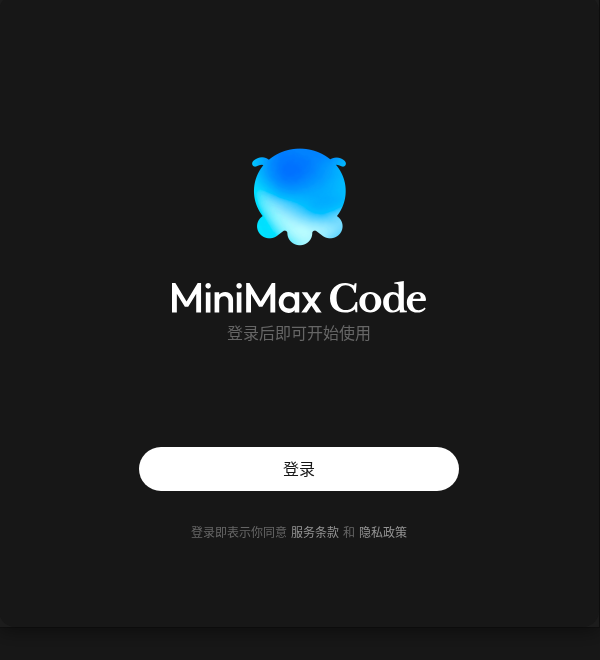

# MiniMax Code for Linux

Unofficial Linux build of the MiniMax Code desktop client. The official desktop
app ships only for Windows and macOS, so this directory contains a reproducible
repackaging pipeline that turns the official Windows installer into a Linux
application and a Debian package.

<p align="center">
  
</p>

<p align="center">
  
</p>

## Status

- Verified on Debian 13 (trixie), arm64, with MiniMax Code 3.1.13 and Electron 42.11.16.
- Login, the task workspace, the embedded terminal, and native modules were tested.
- The build is not published or supported by MiniMax. MiniMax Code itself stays
  proprietary and is subject to MiniMax's terms of service.

## Requirements

- Linux on the same CPU architecture you build for (`arm64` or `x64`); native
  modules are compiled locally, so cross-arch builds are not supported out of the box.
- Node.js 20 or newer, npm, python3, g++, make.
- `7z` (`p7zip-full`), `curl`, `tar`, `dpkg-deb`.
- The official Windows installer for the same release. It is not included in this
  repository; download it from MiniMax and place it in the repository root, in
  `$BUILD_DIR/installers`, or pass `--installer`.
- Network access to npm (defaults to the npmmirror registry) and to the Electron mirror.

On Debian/Ubuntu:

```bash
sudo apt install nodejs npm p7zip-full build-essential python3 curl dpkg-dev
```

## Build

From the repository root:

```bash
./desktop/build-linux.sh --installer "/path/to/MiniMax Code Setup 3.1.13.exe" --portable
```

The script detects the architecture from `uname -m`. Outputs:

- `desktop/dist/minimax-code_<version>_<arch>.deb` — installable Debian package.
- `desktop/dist/MiniMaxCode-<version>-linux-<arch>.tar.gz` — portable archive
  (only with `--portable`).
- `$BUILD_DIR/work/pkg/MiniMaxCode-<version>-linux-<arch>/` — the assembled
  application directory. `BUILD_DIR` defaults to
  `${XDG_CACHE_HOME:-$HOME/.cache}/minimax-code-linux-build`, so the multi-gigabyte
  intermediate tree stays outside the repository.

Options:

| Option | Description |
| --- | --- |
| `--installer <path>` | Official `MiniMax Code Setup <version>.exe`. |
| `--arch <arm64\|x64>` | Target architecture. Must match the build host. |
| `--electron-version <ver>` | Electron version bundled by the installer. Default `42.11.16`. |
| `--registry <url>` | npm registry. Default `https://registry.npmmirror.com`. |
| `--portable` | Also produce a `.tar.gz` archive. |

Environment variables with the same names (`INSTALLER`, `ARCH`, `ELECTRON_VERSION`,
`NPM_REGISTRY`, `ELECTRON_MIRROR`) are also accepted, plus `BUILD_DIR` (intermediate
output location) and `DEB_COMPRESS` (Debian compression, default `xz`). Setting
`DEB_COMPRESS=zstd` produces the package faster on hosts whose `dpkg` supports zstd;
the default `xz` keeps the package installable on older releases such as Ubuntu 22.04.

### Updating to a new MiniMax Code release

1. Download the matching official Windows installer.
2. Check which Electron version it bundles and pass it explicitly when it differs
   from the default, for example `--electron-version 43.1.0`.
3. Run the build again. Native module and platform package versions are read from
   the extracted app, so they follow the release automatically.

## Install

```bash
sudo apt install ./desktop/dist/minimax-code_3.1.13_arm64.deb
minimax-code
```

The package installs to `/opt/minimax-code`, adds `/usr/bin/minimax-code`, the
desktop entry, the icon, and the `minimax-cn://` / `minimax://` URL handlers. The
post-install script marks Chromium's `chrome-sandbox` helper as setuid root.

For the portable archive:

```bash
tar -xzf MiniMaxCode-3.1.13-linux-arm64.tar.gz
cd MiniMaxCode-3.1.13-linux-arm64
./minimax-code
```

Run the portable build with `--no-sandbox` if the kernel does not allow
unprivileged user namespaces for unconfined applications.

## What the build does

1. Extracts the NSIS installer and selects its architecture-specific payload
   (`app-arm64.7z` or `app-64.7z`).
2. Downloads the matching official Electron Linux runtime and Electron headers.
3. Extracts `app.asar`, restoring the unpacked native modules.
4. Applies the Linux-only tray patch. Electron does not emit `click` or
   `right-click` events for tray icons on Linux, so the upstream code that builds
   the context menu on right-click leaves an empty menu; the patch attaches the
   same menu with `setContextMenu()` instead.
5. Installs the Linux builds of every optional platform package declared by the
   app (`@vscode/ripgrep`, `@napi-rs/keyring`, clipboard, screenshots, computer-use
   driver, browser runtime, and so on).
6. Rebuilds `better-sqlite3` and `node-pty` against the Electron ABI with
   `node-gyp`.
7. Repacks `app.asar` with `node_modules` unpacked, assembles the runtime, and
   creates the `.deb` (or portable archive). The launcher exports
   `ELECTRON_FORCE_IS_PACKAGED=true`: without it Electron reports
   `app.isPackaged === false` when the app is started from the application menu,
   and the desktop UI then takes its source-checkout paths, so the local service
   fails with `utility runtime initialization handshake failed`.

Apart from that tray patch, no application code is changed: the desktop code
already contains Linux branches for windows, the sandbox and the terminal. The
patch is anchored on the shipped source and skips itself with a warning when a new
app release changes that code.

## Known limitations

- Windows-only extras are unavailable: browser profile import (`session-transfer`),
  `abe-broker`, the packaged `computer-use` payload, and Windows-only `mcode-tools`
  helpers. The related features disable themselves.
- Auto-update is disabled on Linux; upgrade by installing a newly built package.
- The first login attempt can fail with `登录失败，请重试` if a previous login was
  interrupted and its authorization lease is still active. Start the login again
  to obtain a fresh device code, or remove the stale state and restart:
  `rm ~/.minimax/auth/prod/cn/mcode-public/auth-state.json`.
- GPU acceleration depends on the host driver. If the window stays blank, start
  the app with `--disable-gpu`.
- If Chromium reports a sandbox helper error, run `minimax-code --no-sandbox`
  (portable builds) or reinstall the `.deb` so the setuid helper is restored.

Logs are written to `~/.config/MiniMax/logs/`.

## Layout

```text
desktop/
├── build-linux.sh              # build entry point
├── dist/                       # generated packages (not committed)
├── assets/
│   ├── icon.png                # 256x256 application icon
│   └── launcher.sh             # portable launcher
├── debian/
│   ├── control.in              # Debian control template
│   ├── copyright
│   ├── minimax-code.desktop
│   ├── postinst
│   └── postrm
├── screenshots/
└── scripts/
    ├── asar-placeholders.mjs
    ├── install-platform-packages.mjs
    └── patch-app.mjs
```
